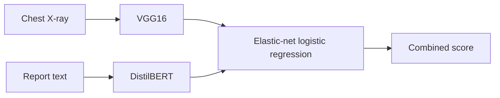

# Comparing image and text fusion for pleural effusion classification

I explored how to combine chest X-rays with clinical report text for pleural effusion classification. I compared early, joint and late fusion, fine-tuned VGG16 and DistilBERT, and used Hugging Face PEFT with LoRA in the project. In the late-fusion approach, I used elastic-net logistic regression to combine model outputs.

## Where fusion happens

| Strategy | Where image and text meet |
|---|---|
| Early fusion | Combine features before passing them to a shared classifier. |
| Joint fusion | Train the branches and fusion head together so the classification loss can shape both representations. |
| Late fusion | Combine predictions from the two branches after each branch produces a score. |

**Fictional example.** Imagine an X-ray and an accompanying note that reads “Left basal opacity is present.” The image and text branches each produce a score for the same example. The late-fusion classifier takes both scores and learns how to weight them. The sentence is invented for this example.

## What I would check in a follow-up evaluation

I would compare image-only, text-only and fused models on the same patient-level holdout. I would also check when reports became available and whether they explicitly named the target diagnosis. If the intended use is classification before a report is written, including that report would give the system information it would lack at prediction time. If the intended task is retrospective coding with reports available, the same words can be valid inputs, and the text-only baseline shows what the image adds.
